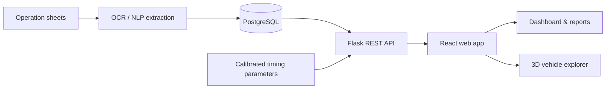

<h1 align="center">ProStream</h1>

<b>Intelligent Automotive Assembly Process and Time-Estimation Platform</b>

OCR · NLP · Heuristic modelling · AI-assisted 3D explorer · Dynamic reporting

> **Note:** This repository is a project showcase. The source code and production data belong to an industrial collaboration and are kept private for confidentiality. A live demo can be provided on request.

## Motivation

Traditional stopwatch time studies are slow, resource-intensive and prone to evaluator bias and measurement error. At the same time, a modern vehicle line contains roughly 800–1,000 assembly operations that must be balanced across workstations under precedence and operational constraints, a task that can take 30–60 working days by hand.

ProStream addresses both problems: it estimates standard times **without physical presence on the assembly line**, and it structures process knowledge so it can be reused and analysed.

## System overview

| Layer | What it does |
|---|---|
| **1. Extraction** | An OCR/NLP pipeline reads assembly process sheets and converts work elements, tools and operation sequences into structured database records. |
| **2. Estimation** | A heuristic framework combines tool-use time, manual-work time and allowances with established work-measurement techniques (**BasicMOST** and **MTM**) to estimate **Normal Time**, **Cycle Time** and **Design Standard Time**. |
| **3. Exploration & reporting** | A 3D vehicle explorer and a dynamic reporting dashboard give fast, flexible access to processes and key performance indicators. |

## Architecture

ProStream is a full-stack system that I designed and built end to end: data extraction, a relational data model, a REST API, the estimation logic and the web interface.

## Data model and API

The PostgreSQL schema covers assembly processes, vehicle models, tools and tool stations, calibrated parameter tables (tool-type, manual-task, shipping and unpacking parameters) and stored calculation results. A REST API with about 35 endpoints exposes these resources and computes **Design Standard Time**. Schema changes are managed with versioned migrations.

## AI-assisted 3D vehicle explorer

Assembly processes are classified into **14 predefined vehicle zones**: engine bay, windshield & wipers, four doors, dashboard, roof, interior pillars, seats & seat belts, trunk, chassis & underbody, front fascia, and wheels & tires.

**Classification and expert validation.** A large language model evaluates each process against the 14 controlled zones using structured process context and returns a zone, a vehicle side, a sub-zone and a **confidence score**. Predictions with at least 70 % confidence are marked as high confidence; all others enter a review queue. A dedicated mapping console lets experts classify processes in batch, filter them by status (high confidence, needs review, failed, manual, pending), and confirm or override any prediction. Manual decisions are stored with full confidence and tracked separately from AI predictions.

**Interactive exploration.** Engineers can:
- hover and click zones directly on the 3D model, with live outline highlighting
- fly the camera to a zone-specific viewpoint, with orbit, tilt and zoom controls and an interior view
- search processes by code, operation name, model, part name or part number, and focus the matching zone
- review the processes of a zone in a side panel, edit a process, or export it as a document

The viewer is model-agnostic: each vehicle has its own configuration (glTF asset, mesh-to-zone dictionary, camera and transform), and unknown models fall back to a default configuration. Models are streamed as Meshopt-compressed glTF, and loading failures degrade gracefully.

## Validation

ProStream's estimates were compared with stopwatch measurements across the evaluated processes and showed a deviation of **4–10 %**. Calibration of the timing parameters is iterative: deviations are analysed per process, and the parameters of the timing model are adjusted accordingly.

## Ongoing research

My dissertation investigates **machine-learning-based assembly-line balancing**: using process times, precedence relations and production-hall constraints to build an optimization model for task allocation, workstation workload distribution and operator requirements. Model evaluation is still pending.

## Technology

- **Frontend:** React · TypeScript · Three.js · React Three Fiber · drei · glTF (Meshopt)
- **Backend:** Python · Flask · SQLAlchemy · Alembic migrations · REST API
- **Database:** PostgreSQL
- **AI:** OCR/NLP document extraction · LLM-based zone classification (Google Gemini) · heuristic estimation models

## My role

Technical Lead. I conceived the project and independently developed the end-to-end platform, from problem formulation and the estimation model to the data pipeline, the API and the web application.

## Status

In development since August 2024 in collaboration with an automotive manufacturer.

## Contact

Niusha Shamsikhani · niusha.s2015@gmail.com
