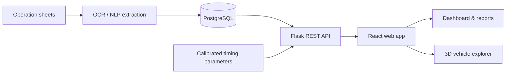

<h1 align="center">ProStream</h1>

<b>Intelligent Automotive Assembly Process and Time-Estimation Platform</b>

OCR · NLP · Heuristic modelling · AI-assisted 3D explorer · Dynamic reporting

> **Note:** This repository is a project showcase. The source code and production data belong to an industrial collaboration and are kept private for confidentiality. A live demo can be provided on request.

## Motivation

Traditional stopwatch time studies are slow, resource-intensive and prone to evaluator bias and measurement error. At the same time, a modern vehicle line contains roughly 800–1,000 assembly operations that must be balanced across workstations under precedence and operational constraints, a task that can take 30–60 working days by hand.

ProStream addresses both problems: it estimates standard times **without physical presence on the assembly line**, and it structures process knowledge so it can be reused and analysed.

## System overview

| Layer | What it does |
|---|---|
| **1. Extraction** | An OCR/NLP pipeline reads assembly process sheets and converts work elements, tools and operation sequences into structured database records. |
| **2. Estimation** | A heuristic framework combines tool-use time, manual-work time and allowances with established work-measurement techniques (**BasicMOST** and **MTM**) to estimate **Normal Time**, **Cycle Time** and **Design Standard Time**. |
| **3. Exploration & reporting** | A 3D vehicle explorer and a dynamic reporting dashboard give fast, flexible access to processes and key performance indicators. |

## Architecture

ProStream is a full-stack system that I designed and built end to end: data extraction, a relational data model, a REST API, the estimation logic and the web interface.

## Data model and API

The PostgreSQL schema covers assembly processes, vehicle models, tools and tool stations, calibrated parameter tables (tool-type, manual-task, shipping and unpacking parameters) and stored calculation results. A REST API with about 35 endpoints exposes these resources and computes **Design Standard Time**. Schema changes are managed with versioned migrations.
